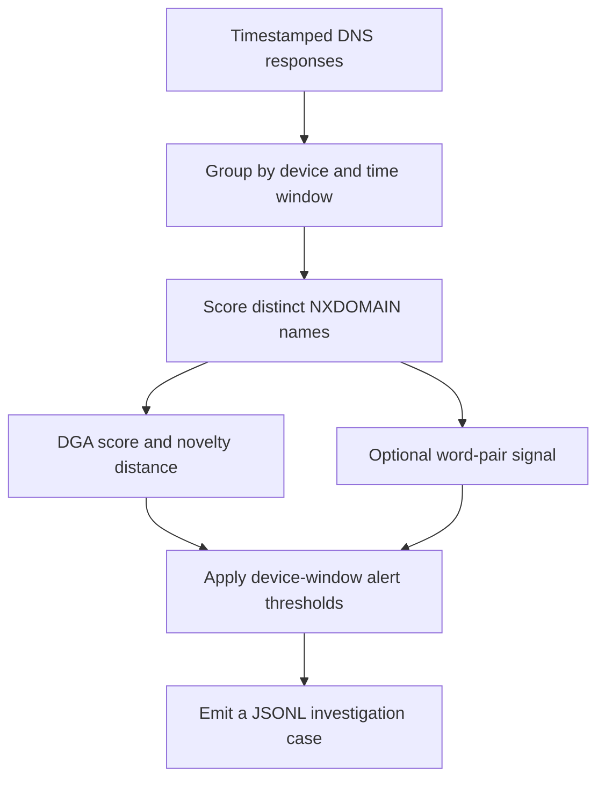
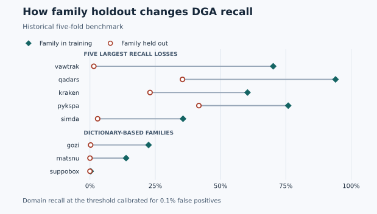

# nxdomain-sentinel

NXDOMAIN Sentinel is an open-source research prototype for investigating
domain generation algorithm (DGA) activity in DNS logs. It scores failed
lookups, groups the evidence by device and time window, and emits JSONL cases
for analyst review. The benchmark compares alert policies on later labeled
windows using thresholds set under a shared calibration alert budget.

[Try the synthetic benchmark](#try-the-synthetic-benchmark) ·
[Replay DNS logs](#replay-dns-logs-for-triage) ·
[Review the historical results](#headline-result)

## From DNS logs to an investigation case



NXDOMAIN is the DNS response indicating that a queried name does not exist.
The DGA score measures how generated a name looks. Novelty measures how far
its embedding is from known DGA families and can be high even when its DGA
score is low. The replay combines those signals with multiple distinct failed
lookups from the same device. A case can include the flagged names, query
counts, timestamps, and scores that prompted review.

| Evidence | Status |
|---|---|
| Historical domain classifier | Five family-held-out folds evaluated on the public corpus |
| Replay, scoring API, and benchmark | Exercised locally, including a replay with synthetic DNS traffic |
| Benefit of novelty and word pairs on real networks | Pending a pilot with authorized resolver logs and reviewed case labels |
| Private Cloud Run service | Deployment workflow prepared. Live verification pending |

## Development progress

- **Independent novelty signal implemented.** Both scoring endpoints return
  `above_novelty_threshold` for every scored domain. It measures distance from
  known DGA families and is `null` for unparseable input. `is_novel` retains
  its original meaning: the domain crossed both the DGA and novelty thresholds.
- **Benign novelty evaluation added.** Run `make eval` with trained checkpoints
  to report benign sample counts above the standalone and combined thresholds
  for each fold and partition. Calibration uses known DGA samples in validation.
  The checked-in results predate this evaluation.

- **Alert-only DNS replay implemented.** A local command groups DNS responses
  by pseudonymous device and time window, scores distinct NXDOMAIN names, and
  emits JSONL cases for investigation or SIEM ingestion. The initial rules are
  pilot defaults awaiting calibration on authorized resolver telemetry.

- **Forward-in-time replay benchmark implemented.** The existing paired
  family holdout stays in place. The replay benchmark compares five detection
  policies under one calibration budget, with later labeled device windows
  and an optional second network. No pilot performance is claimed yet.

- **Dictionary-DGA experiment implemented.** An optional word segmentation
  and word-pair signal participates in the same replay and alert-budget
  benchmark. Its effect on real dictionary families still needs measurement.

- **Deployment hardening implemented.** Requests are size-limited, the
  serving checkpoint is verified by SHA-256 in Cloud Run, and deployment
  is private and manually triggered. Source revisions and the public suffix
  snapshot dependency are pinned for new builds. Live cloud verification is
  pending environment setup.

## Headline result

**Holding a family out costs a median 5.6 points of recall and a mean 14.9
points** across 25 families, using the threshold calibrated for a 0.1% false
positive rate. This is the historical domain-level result.



*Figure source* [Checked-in paired family results](artifacts/analysis.json).
Vawtrak recall fell from 70.2% with the family in training to 1.5% with the
family held out. The lower three rows show the dictionary-based families.

That gap is measured by pairing. Every family is held out in exactly one fold
and trained in the other four, so each family is compared against *itself*.
Family difficulty appears on both sides of the subtraction and cancels. This
matters, because the naive comparison is actively misleading: in fold 0 the
unseen partition scored *higher* than the seen one, purely because that fold
happened to hold out five easy random-string families while the seen partition
kept every hard one.

Mean and median diverge sharply because the damage is concentrated:

| family | recall trained | recall held out | cost |
|---|---|---|---|
| vawtrak | 0.7017 | 0.0147 | **+0.687** |
| qadars | 0.9403 | 0.3542 | +0.586 |
| kraken | 0.6033 | 0.2299 | +0.373 |
| pykspa | 0.7592 | 0.4170 | +0.342 |
| simda | 0.3563 | 0.0293 | +0.327 |
| … | | | |
| murofet | 0.9685 | 0.9687 | −0.000 |
| necurs | 0.7576 | 0.7931 | −0.036 |

Most families transfer nearly free. A handful collapse completely. A single
averaged number hides which is which, which is why the per-family table is the
result and the mean is a footnote.

## Dictionary-based families

The historical character CNN had low recall on the three dictionary-based
families even when those families were represented in training.

suppobox, matsnu and gozi build domains by concatenating real words, so their
output looks like ordinary registered names. Recall on suppobox is 0.0000 when
held out, and 0.0028 when it is sitting *in the training set*. matsnu reaches
0.1382 trained. gozi reaches 0.2244 trained.

The word-pair feature in the replay is an experiment motivated by this gap.
The family-level results show which families warrant separate evaluation.

---

## The novelty gate

The classifier estimates whether a name resembles a generated domain. The
novelty gate measures distance from the known-family clusters. Nearest-family
similarity can support investigation alongside other evidence.

The gate fits one Gaussian per known family in the classifier's penultimate
space with a pooled, shrunk covariance, and scores Mahalanobis distance to the
nearest centroid. No OOD data is needed to fit it.

**Median per-family AUC 0.7211. Fourteen of 25 families above 0.70, eight below
0.50.**

Fold 1 had a pooled AUC of 0.5237. Per-family values ranged from 0.3111 on
Emotet to 0.8802 on Suppobox. That spread shows how differently the gate
ranked individual held-out families against the known-DGA reference.

**The standalone gate adds a different signal.** In the offline Suppobox
comparison, classifier recall was 0.0000 and gate AUC was 0.8802. The novelty
score alone flagged 34% of Suppobox samples at a cutoff that flagged 5% of the
known-DGA reference. The replay benchmark measures whether this signal helps
with benign background traffic and a limited alert budget.

### Where the style hypothesis stands

I predicted the gate would fire specifically when a held-out family's
*generation style* was absent from training. Dictionary families average 0.8038
against 0.6551 for random-string families, a gap of +0.149 in the predicted
direction.

I would not call that settled. There are only three dictionary families, and the
four highest gate scores in the table are random-string families (qadars and
nymaim at 0.9623, symmi 0.9437, vawtrak 0.9401). The direction is right and the
sample is too small to lean on.

---

## Serving

| batch | p50 | p95 | p99 | per domain |
|---|---|---|---|---|
| 1 | 1.52 ms | 1.71 ms | 1.83 ms | 1.525 ms |
| 10 | 10.55 ms | 11.34 ms | 14.53 ms | 1.055 ms |
| 100 | 102.98 ms | 107.50 ms | 109.71 ms | 1.030 ms |
| 500 | 481.51 ms | 506.97 ms | 512.57 ms | 0.963 ms |

In-process inference on one core, excluding HTTP and network. End-to-end numbers
require the deployed service and are not claimed here.

The serving artifact is **0.57 MB** and carries weights, the novelty gate, the
decision threshold, the novelty threshold, the family list, and the gate's
measured AUC in one file. A threshold separated from the model it was calibrated
on is a production incident waiting to happen.

Because the artifact carries its measured gate AUC, **the API labels its own
novelty field as unproven** whenever that AUC falls below 0.70. A field that
means nothing is worse than no field.

```bash
curl -X POST https://<service>/v1/score \
  -H 'Content-Type: application/json' \
  -d '{"domain":"cvyh1po636avyrsxebwbkn7.ddns.net"}'
```

```json
{
  "domain": "cvyh1po636avyrsxebwbkn7.ddns.net",
  "core": "cvyh1po636avyrsxebwbkn7",
  "verdict": "dga",
  "dga_probability": 0.998,
  "nearest_family": "corebot",
  "novelty_score": 84.2,
  "is_novel": false,
  "above_novelty_threshold": false
}
```

Note `core`. **The model never sees a TLD.** In the training corpus corebot
arrives as `<random>.ddns.net` while most benign samples end in `.com`. A
character model handed the full name learns "ends in ddns.net" and reports a
spectacular score that collapses the first time a family changes registrar.
Everything right of the public suffix is stripped before encoding, using a
pinned Public Suffix List snapshot with private domains enabled. TLD reputation
is a real signal and a real defence should use it. It is excluded so the
reported generalisation describes the string model rather than a registrar
lookup in disguise.

---

## Usage

### Try the synthetic benchmark

From a clean checkout, this demo runs with Python and two small fixtures.

```bash
python scripts/benchmark_replay.py docs/examples/synthetic-windows.jsonl \
  docs/examples/synthetic-labels.jsonl --calibration-end 300 --test-start 86400 \
  --alerts-per-1000-device-days 500
```

The earlier windows set the thresholds. The later windows contain one
fictional dictionary-DGA episode and two reviewed benign cases. The scripted
DGA score misses the episode. The novelty signal catches it and also flags a
benign lookalike.

| Policy | Test alerts | Toy episodes found | Reviewed precision |
|---|---:|---:|---:|
| Behavior only | 0 | 0 of 1 | — |
| CNN only | 1 | 0 of 1 | 0% |
| Novelty only | 2 | 1 of 1 | 50% |
| CNN + novelty | 3 | 1 of 1 | 33% |
| CNN + novelty + behavior | 2 | 1 of 1 | 50% |

The counts come from [synthetic device windows](docs/examples/synthetic-windows.jsonl)
and [synthetic labels](docs/examples/synthetic-labels.jsonl). They illustrate
how the benchmark reports detection and alert volume when policies are
calibrated on one period and tested on a later one.

### Replay DNS logs for triage

With a trusted model from `make export`:

```bash
export NXS_REPLAY_HMAC_KEY="$(python -c 'import secrets; print(secrets.token_hex(32))')"
python scripts/replay_dns.py dns.jsonl > cases.jsonl
```

Input is timestamp-ordered [Zeek JSON DNS logs](https://docs.zeek.org/en/master/reference/logs/dns.html)
from the client side of the resolver, or normalized JSONL with Unix seconds
`ts`, string `client`, string `query`, and numeric `rcode`.
For Unbound, convert dnstap client responses to the normalized format first.
Only RCODE 3 is scored. All usable responses contribute to window totals.
Entries without a query or response code are skipped and counted on stderr.

The default rule emits one case per device per five-minute window when at
least five different names returned NXDOMAIN and at least two crossed the
classifier or standalone novelty threshold. `--all-windows` includes
non-alert windows for evaluation. Case IDs are stable for the same key,
device identifier and window size. Retain the secret across replays of one
dataset and isolate it per environment. Case evidence includes raw query
names and first/last query times. Use `--evidence-limit 0` to emit counts
without query names. Keep logs and cases local with restricted access and
limited retention.
If a replay exits with an error, discard its partial output.

### Benchmark a replay

Run the replay with `--all-windows` so device-day exposure includes quiet
windows. Use a reviewed labels JSONL file keyed by `case_id`. Reviewed benign
windows have `"status":"benign"`. Malicious windows have `"status":"malicious"`
and include `episode_id`, `episode_start` (Unix seconds), `family`, and
`style` (for example `dictionary`). Include all observable windows of known
test episodes, even when the replay did not alert. Leave unreviewed windows
unlabeled. Add authorized dictionary-DGA captures to this test as a distinct
cohort, with benign lookalikes in the background.

```bash
python scripts/replay_dns.py dns.jsonl --all-windows > windows.jsonl
python scripts/benchmark_replay.py windows.jsonl labels.jsonl \
  --calibration-end 1764547200 --test-start 1764547200 \
  --alerts-per-1000-device-days 10 > benchmark.json
```

Use cutoffs appropriate for your capture. Complete earlier windows set the
threshold for each policy under the same budget. Score ties stay together,
which can leave part of the budget unused. Later windows are scored with
frozen thresholds, so realized alert rates can differ. For a second network,
pass `--test-features other-windows.jsonl` scored with the same model and
window duration. Device-days count observed devices per UTC window-start day.

The report includes reviewed-case precision, unreviewed alerts, confirmed
false alerts per 1,000 device-days, episode counts by family and style, and
median delay to the first alert among detected episodes that started during
the test. Pass `--model artifacts/serving_model.pt` for a seen versus unseen
family breakdown based on that exact artifact. Use family labels consistent
with the training corpus. Confirmed false alerts are a lower bound with partial review.
The checked-in family-held-out domain results are separate from this replay.

### Run the dictionary-DGA experiment

Build a lexical artifact with a fixed, licensed English word list and a
separate benign reference collected before the calibration and test windows.
Both input files have one entry per line. Record their versions and hashes
with the experiment.

```bash
python scripts/build_lexicon.py words.txt earlier-benign-domains.txt artifacts/lexicon.json
python scripts/replay_dns.py dns.jsonl --lexicon artifacts/lexicon.json --all-windows > windows.jsonl
```

The feature segments the registrable label into words and flags adjacent pairs
absent from the benign reference. Re-run the benchmark with these windows
to compare the fused rule with and without the lexical signal. The report
records the artifact SHA-256. Benign brands and compound names can trigger
this signal, so review the added alerts alongside dictionary-family recall.

### Inspect novelty alongside DNS behavior

Use `above_novelty_threshold` to inspect distances even when the DGA score is
low. A domain that crosses the distance threshold may be an unfamiliar benign
name. Repeated behavior and corroborating evidence can make it worth
investigating. Suppobox's reported 34% is the standalone offline flag rate at a
5% flag rate among known DGAs.

### Pre-filter before expensive analysis

At roughly 1 ms per domain this is cheap enough to sit in front of anything that
is not. Sandbox detonation, WHOIS enrichment, passive DNS lookups and commercial
reputation APIs all cost orders of magnitude more per query. Use the classifier
to decide what deserves them.

### Reuse the evaluation harness

The most portable part of this repository is not the model, it is
`data/splits.py` and `train/evaluate.py`. Swap in any DGA detector and you get
family holdout, frozen thresholds, leakage assertions and per-family breakdowns
for free. If you are writing a paper in this area, the harness will tell you how
much of your reported number came from the random shuffle.

### Teach the open-world gap

Fold 0 is a ready-made lesson. The unseen partition scores *higher* than the
seen one, and the reason is entirely about which families landed where. It is a
compact demonstration of why a single held-out split cannot answer a
generalisation question.

## Private deployment and latency

Cloud Run uses authenticated invocation. Grant `roles/run.invoker` to
specific principals, including the deployment service account used by the
smoke test. With Terraform, use `invoker_members` and supply
`model_sha256` for the artifact inside the image.

The GitHub Actions **deploy** workflow is manually dispatched. Configure the
`production` environment with the existing WIF and deployment secrets
(`WIF_PROVIDER`, `DEPLOY_SA`, `GCP_PROJECT`, `MODEL_URI`) and set
`MODEL_SHA256` to the full lowercase digest printed by `make export`.
The workflow checks the artifact before building, verifies startup against
the same digest, and tests both anonymous rejection and authenticated scoring.
Only use model artifacts from your trusted build and release path.

Local scoring remains available on loopback. Both endpoints cap domain length
at 253 characters, the batch route defaults to 500 domains, and request bodies
are capped at 1 MiB. Replay runs locally against the model file and can verify
it with `NXS_MODEL_SHA256`.

To measure HTTP p50, p95 and p99 latency, run:

```bash
python bench/http_latency.py http://127.0.0.1:8080 --batch-size 100 --concurrency 4
```

For Cloud Run, use the HTTPS service URL and pass an audience-appropriate
ID token via `NXS_BENCH_TOKEN`. The tool measures direct HTTP requests and reports the first request separately.
An idle run is required to study cold starts. The replay command reports total
wall time on stderr, while the replay benchmark reports detection delay on the
capture timeline. These measure different parts of the system.

## Data

The public sources are pinned in `src/nxsentinel/data/sources.py`. A new
build records their revisions and the preprocessing dependency version in
`data/processed/dataset_report.json`. If a cached checkout differs, run
`python scripts/build_dataset.py --force-download` to rebuild with the pinned
sources. The historical figures below are retained as originally reported.

| role | source | contents |
|---|---|---|
| training | [chrmor/DGA_domains_dataset](https://github.com/chrmor/DGA_domains_dataset) | 25 families at 13,500 each, plus matched benign |
| cross-source DGA | [baderj/domain_generation_algorithms](https://github.com/baderj/domain_generation_algorithms) | per-family example domains, 16 usable unseen families |
| cross-source benign | [zer0h/top-1000000-domains](https://github.com/zer0h/top-1000000-domains) | independent top-domains ranking |

Only checked-in example files are read from the generator repository. The
generator scripts are never imported or executed.

**827,924 domains** after normalisation and deduplication, 350,789 malicious and
477,135 benign. Three things the build catches:

- **42,148 benign domains** appear in both benign corpora. Deduplicated globally
  on the normalised core.
- **47 label conflicts**, domains present as both benign and malicious. These are
  short-string families such as symmi generating four-character labels that
  collide with real registrations. Dropped rather than arbitrarily assigned.
- `nan.com`, `inf.com`, `na.com` and `null.com` are real registrations that
  pandas converts to floats under default NA handling. Every read path disables
  NA coercion, with regression tests.

---

## Reproducing

```bash
git clone https://github.com/ucchol/nxdomain-sentinel.git
cd nxdomain-sentinel

make install        # CPU-only torch
make data           # clones corpora, builds splits, ~2 min
make test           # unit and API tests
make train          # 5 folds
make eval           # scores every checkpoint
make analyze        # paired per-family comparison
make export bench   # serving artifact and latency table
make serve          # local API on :8080
```

Training and evaluation are separate commands with a checkpoint between them, so
an evaluation failure costs seconds rather than the whole training run. Folds
materialise one at a time; building all five copies 3.4 million rows and was the
actual cause of repeated out-of-memory kills during development.

## Layout

```
src/nxsentinel/
  data/normalize.py    public-suffix stripping, the anti-shortcut logic
  data/build.py        assembly, deduplication, conflict handling
  data/splits.py       family holdout, leakage assertions
  model/charcnn.py     character CNN, 96,917 params, two heads
  model/ood.py         Mahalanobis novelty gate
  train/evaluate.py    metrics, frozen thresholds, per-family breakdowns
  serve/               FastAPI app, predictor, web UI
scripts/               build_dataset, train, evaluate, analyze, export_model
infra/                 Terraform for Cloud Run
bench/                 latency harness
```

Thresholds are calibrated on validation and frozen before any test partition is
touched. The leakage suite asserts that a deliberately constructed leak is
*detected*, because a split bug does not crash, it quietly raises every score.

## Pilot boundaries

- Replay is alert-only. Analysts use the case evidence to investigate.
- Device grouping depends on where the DNS logs are collected and how
  reliably the source identifier represents an endpoint.
- The public corpus uses historical benign domain lists. Measure false
  alerts and episode recall on current resolver data before relying on the
  suggested thresholds.
- Only three dictionary families appear in the original holdout corpus.
  Evaluate the optional word-pair feature with additional labeled episodes
  and benign lookalikes.
- Published latency is in-process. The HTTP benchmark can measure the
  deployed service, including startup and tail latency.

## Related work

The novelty gate follows the class-conditional approach in *MAD-OOD: A Deep
Learning Cluster-Driven Framework for an Out-of-Distribution Malware Detection
and Classification* (TrustCom 2025), and the classifier line continues
*Fine-tuning Large Language Models for DGA and DNS Exfiltration Detection*
(ACSAC Workshops 2024, [arXiv:2410.21723](https://arxiv.org/abs/2410.21723)).

## Author

Asif Rahman, PhD candidate in Computer Science at the University of Texas at
El Paso. [ucchol.github.io](https://ucchol.github.io) ·
[Google Scholar](https://scholar.google.com/citations?user=FfLKS8AAAAAJ) ·
[GitHub](https://github.com/ucchol)

## License

MIT. See [LICENSE](LICENSE).
